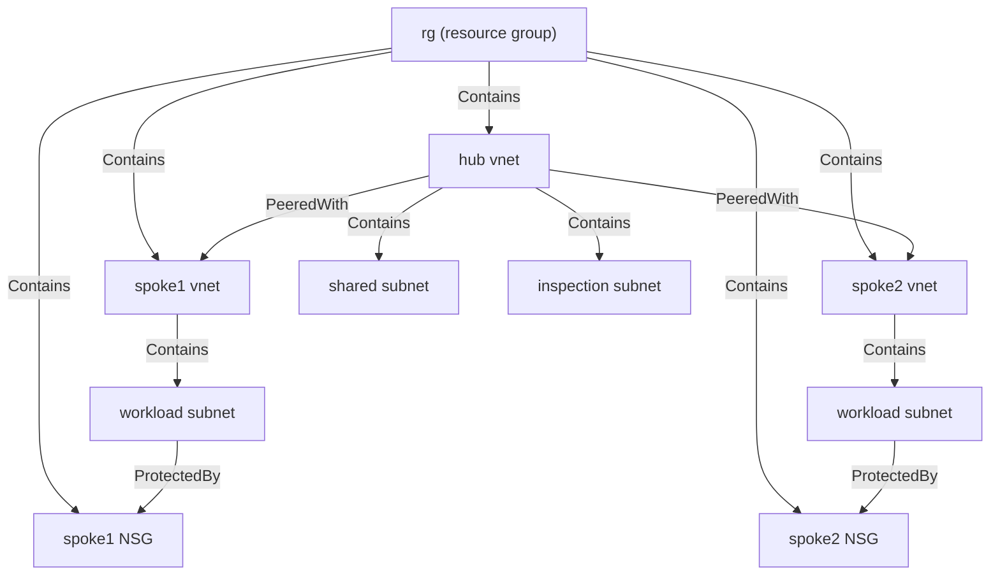

# Radivum

[](https://github.com/radivum/radivum-oss/actions/workflows/ci.yml)
[](https://www.nuget.org/packages/radivum-oss)
[](LICENSE)
[](https://dotnet.microsoft.com/)

**Collect and document an Azure network from your own sign-in.** One command reads the network you can
already see, writes a versioned snapshot, a Markdown report and a Mermaid topology, and uploads nothing.

Try the [interactive demo](https://www.radivum.com/demo) - a sample estate, no sign-in - or read the
[product site](https://www.radivum.com). The [Radivum Workbench](https://app.radivum.com) renders these artifacts
and requires a sign-in.

## What you get

- **A network inventory** from Azure Resource Graph and ARM, using your own identity: virtual networks and
  subnets, peerings, NSGs and their attachments, route tables, NICs, public IPs, private endpoints, private DNS
  zones, firewalls, Virtual WAN hubs, ExpressRoute circuits and gateways.
- **A versioned snapshot** (`network-snapshot.json`) that decouples the estate from the raw ARM responses, so
  later tools read one stable contract instead of Azure's.
- **Level 1 configuration findings** for the checks that do not need effective routing: subnets without an NSG,
  overly permissive rules, unused route tables, public exposure and similar.
- **A Markdown report** (`network-report.md`): inventory, topology, collection coverage and findings, ready to
  paste into a design document.
- **A Mermaid topology** (`network-topology.md`) and the same graph as JSON (`network-graph.json`), so the
  diagram renders on GitHub, in VS Code, in a wiki, or in your own tooling.
- **An analysis manifest** (`analysis-manifest.json`): what the run produced, with a SHA-256 per artifact and a
  declared state for every capability, so a reader never has to guess what is missing and why.

The sample estate in this repository — a hub with two spokes, each spoke protected by its own NSG — renders as:



That is the graph of `samples/network-snapshot.sample.v1.json`, condensed. The file the tool writes keeps every
node id and every edge.

## Quick start

Prerequisites, both paths: the **.NET 10 SDK** (`dotnet --version` reports 10.x). Path B additionally needs the
**Azure CLI** (`az`) and at least **Reader** on the subscription you want to document.

### Path A — no Azure access (about one minute)

Analyse the committed sample estate and read the result:

```bash
dotnet tool install --global radivum-oss
radivum-oss report --snapshot samples/network-snapshot.sample.v1.json --out ./sample-output
```

Open `sample-output/network-report.md` and `sample-output/network-topology.md`. Nothing is uploaded and no
credential is used: `report` only reads the file you gave it.

### Path B — your own estate (about five minutes)

```bash
az login
radivum-oss login-status                                  # what your identity can see
radivum-oss collect --scope <subscription-id> --out ./output
```

Open `output/network-report.md`. `collect` writes the complete bundle in one run: `network-snapshot.json`,
`findings.json`, `network-report.md`, `network-graph.json`, `network-topology.md` and `analysis-manifest.json`.

- Repeat `--scope` to treat up to three subscriptions of one tenant as one network.
  A resource group scope (`/subscriptions/<id>/resourceGroups/<rg>`) takes exactly one subscription.
- `graph` and `diagram` re-render the graph or the topology from a snapshot you already have, to a file or
  directory of your choice.
- `report` regenerates the report, the graph and the topology from a snapshot.

## What it reads, and what it never does

- **Read-only, with your identity.** Calls go to Azure Resource Graph and Azure Resource Manager through
  `DefaultAzureCredential` (the Azure CLI credential is respected). Inventory reads are `GET`; a Resource Graph
  query is a `POST` because that is the shape of that API — it asks for a query result and writes nothing. The
  tool has no write path, and a missing permission degrades the affected capability rather than failing the run
  silently — the manifest states what could not be read and why.
- **Nothing is uploaded.** Collection and analysis run on the machine you started them on. There is no service
  to call, no account, no usage cap and no expiry.
- **No telemetry.** The tool contains no analytics, no crash reporting and no update check.
- **Credentials are never stored, logged or transmitted.** Nothing is written to `~/.aznw` or anywhere else
  except the output directory you name. See [docs/permissions.md](docs/permissions.md) for the exact endpoints
  and the role you need.
- **Verify what you install.** Packages are built from this repository by public CI and carry a provenance
  attestation; each GitHub Release ships the `.nupkg` with a `SHA256SUMS` file.

## Outputs and formats

| File | Contract | What it is |
|---|---|---|
| `network-snapshot.json` | schema `0.1` | The versioned inventory: scope, collection metadata per resource type, and the resources |
| `network-graph.json` | graph schema `1.0` | A deterministic, renderer-neutral projection of the snapshot: nodes, edges, groups |
| `network-topology.md` | rendering | The same graph as a Mermaid document |
| `network-report.md` | rendering | Inventory, topology, collection coverage and findings as Markdown |
| `findings.json` | schema `0.1` | The machine-readable findings, each with evidence and the resources it concerns |
| `analysis-manifest.json` | schema `0.1` | The index of the run: edition, source kind, artifact digests, per-capability state. Written last, so its presence means the run completed |

The contracts are versioned and documented in [docs/artifacts.md](docs/artifacts.md). Anything may read them;
that is the point of writing them down.

## Commands

| Command | What it does |
|---|---|
| `login-status` | Shows the subscriptions your current login can see |
| `collect --scope <scope> [--out <dir>]` | Collects the inventory and writes the complete bundle |
| `report --snapshot <file> [--out <dir>]` | Regenerates the report, graph and topology from a snapshot |
| `graph --snapshot <file> [--out <dir-or-file>]` | Writes `network-graph.json` again, elsewhere |
| `diagram --snapshot <file> [--out <dir-or-file>] [--format mermaid]` | Writes `network-topology.md` again, elsewhere |

`--resolve-links true` makes a collection look up the target of a NIC or private endpoint reference; the default
is to name the target from its resource id without an extra read. Exit codes are documented in
[docs/cli-reference.md](docs/cli-reference.md), along with every argument.

## Radivum OSS, Radivum Pro and the Workbench

| | Radivum OSS (this repository) | Radivum Pro | [Radivum Workbench](https://app.radivum.com) (sign-in required) |
|---|---|---|---|
| Collection and snapshot | yes | same collector, by design | uses what a host collects |
| Graph, Mermaid topology, Markdown report | yes | yes | renders them |
| Level 1 configuration findings | yes | plus routing and NSG reasoning, trace, consultant report | shows both |
| Account needed | no | licence | sign-in |
| Licence | Apache-2.0 | proprietary | proprietary |

Pro adds interpretation of the same evidence — it never gates access to your own data, and it uses the same
collector, so a Pro run cannot see more than an OSS run. The comparison is in
[docs/edition-comparison.md](docs/edition-comparison.md) and in the site's
[capability and edition comparison](https://www.radivum.com/features#editions-heading); the product site is
[www.radivum.com](https://www.radivum.com).

## Documentation, contributing, support

- [docs/quickstart.md](docs/quickstart.md) — both paths in detail, with troubleshooting
- [docs/cli-reference.md](docs/cli-reference.md) — every command, argument and exit code
- [docs/permissions.md](docs/permissions.md) — the role you need and every endpoint the tool contacts
- [docs/artifacts.md](docs/artifacts.md) — the three contracts and their versioning rules
- [docs/collector-architecture.md](docs/collector-architecture.md) — how a collection is performed
- [CONTRIBUTING.md](CONTRIBUTING.md) — the Developer Certificate of Origin, and how changes reach this repository
- [SECURITY.md](SECURITY.md) — how to report a vulnerability privately
- [SUPPORT.md](SUPPORT.md) — where to ask a question

Issues and pull requests are welcome. Contributions are accepted under the Developer Certificate of Origin (a
`Signed-off-by` line on every commit), not a CLA. Changes are reviewed here and imported into the maintaining
repository by hand, so a merged pull request appears in the next published snapshot.

## Licence and trademarks

Apache-2.0 — see [LICENSE](LICENSE) and [NOTICE](NOTICE). Copyright 2026 Tiger Solutions.

Radivum Pro and the Radivum Workbench are separate, proprietary products. "Radivum" and the Radivum mark are
trademarks of Tiger Solutions; Apache-2.0 grants no trademark rights, and a fork must not present itself as
Radivum. Radivum is not affiliated with Microsoft. Azure is a trademark of Microsoft Corporation. Third-party
components are listed in [THIRD-PARTY-NOTICES.md](THIRD-PARTY-NOTICES.md).
